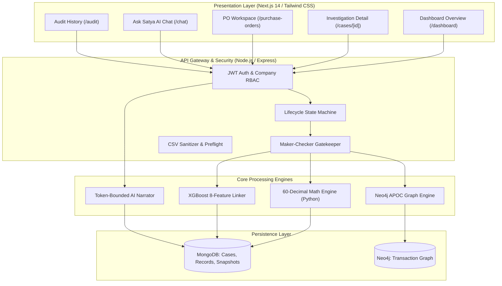
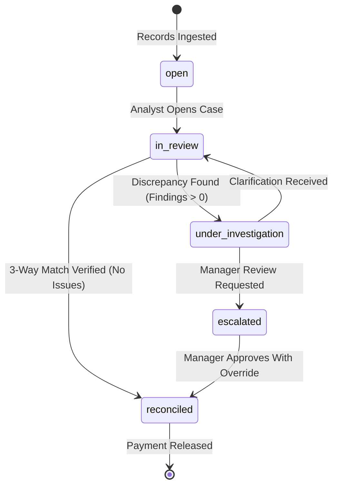

# SATYA AI — TECHNICAL JARGON, RESEARCH & DESIGN DECISIONS HANDBOOK

> **Product Tagline:** *“Know what you actually owe, and why.”*  
> **Repository:** [https://github.com/manikkDev/Satya-IPL](https://github.com/manikkDev/Satya-IPL)  
> **Target Audience:** Engineering Students, Software Architects, Faculty Reviewers, Technical Hackathon Judges, and Systems Engineers  
> **Authoritative Baseline:** Inspected Source Code (`server/`, `ml-fl-service/`, `client/`, `chatbot-backend/`)  
> **Verification Status:** Implementation Complete | Containerized Runtime Testing Deferred to Teammate  

---

# TABLE OF CONTENTS
1. [PART 1 — Technical Ground Truth & System Inventory](#part-1--technical-ground-truth--system-inventory)
2. [PART 2 — Complete Technical Jargon Dictionary (7 Categories)](#part-2--complete-technical-jargon-dictionary)
   - [2.1 Financial & Accounting Terminology](#21-financial--accounting-terminology)
   - [2.2 Backend & API Terminology](#22-backend--api-terminology)
   - [2.3 Database & Data Modeling Terminology](#23-database--data-modeling-terminology)
   - [2.4 AI, ML & Data Science Terminology](#24-ai-ml--data-science-terminology)
   - [2.5 LLM, Chatbot & RAG Terminology](#25-llm-chatbot--rag-terminology)
   - [2.6 Software Architecture & Engineering Terminology](#26-software-architecture--engineering-terminology)
   - [2.7 Security & Governance Terminology](#27-security--governance-terminology)
3. [PART 3 — Algorithmic Deep Dives & Business Rules](#part-3--algorithmic-deep-dives--business-rules)
4. [PART 4 — Technology Selection & Decision Matrix](#part-4--technology-selection--decision-matrix)
5. [PART 5 — Practical End-to-End Walkthroughs](#part-5--practical-end-to-end-walkthroughs)
6. [PART 6 — Research Background & Theoretical Foundations](#part-6--research-background--theoretical-foundations)
7. [PART 7 — Technical Defense Question Bank (35 Questions & Model Answers)](#part-7--technical-defense-question-bank)
8. [PART 8 — System Diagrams, Quick Reference & Common Misconceptions](#part-8--system-diagrams-quick-reference--common-misconceptions)

---

# PART 1 — TECHNICAL GROUND TRUTH & SYSTEM INVENTORY

To establish complete engineering integrity, this handbook is grounded in the actual codebase. Satya AI is not a generic template or mockup; it is a functioning multi-service application composed of four interconnected subsystems:

```
┌─────────────────────────────────────────────────────────────────────────────────────────┐
│                                 SATYA AI REPOSITORY INVENTORY                           │
├──────────────────────────┬──────────────────────┬───────────────────────────────────────┤
│ Subsystem / Directory    │ Core Technology      │ Source-Verified Capabilities          │
├──────────────────────────┼──────────────────────┼───────────────────────────────────────┤
│ client/                  │ Next.js 14, React 18 │ 8 App-Router pages, Radix UI dialogs, │
│                          │ Tailwind CSS         │ BusinessGraph force layout, CSV workspace│
├──────────────────────────┼──────────────────────┼───────────────────────────────────────┤
│ server/                  │ Node.js, Express.js  │ 35+ REST endpoints, JWT auth, MongoDB │
│                          │ Mongoose ODM         │ FSM state engine, SoD maker-checker   │
├──────────────────────────┼──────────────────────┼───────────────────────────────────────┤
│ ml-fl-service/           │ Python 3.10+, Decimal│ 60-decimal math engine, XGBoost 8-feat│
│                          │ XGBoost, Flask       │ record matcher, snapshot state hasher │
├──────────────────────────┼──────────────────────┼───────────────────────────────────────┤
│ chatbot-backend/         │ Node.js, Express.js  │ Token-bounded context grounding, SSE  │
│                          │ LangChain, OpenAI    │ streaming, zero-shot narrative builder│
└──────────────────────────┴──────────────────────┴───────────────────────────────────────┘
```

### Verified Implementation Truth vs. Deferred Testing:
1. **Source-Confirmed Implementation:**
   - Exact Decimal mathematics (`decimal.Decimal(60)` in Python).
   - XGBoost model loading with SHA-256 artifact integrity checking.
   - 7-state finite state machine with strict transition matrices in `server/src/utils/lifecycleAndAnomalyService.js`.
   - Separation of Duties (Maker-Checker): Analysts can request/escalate; only Managers can approve.
   - Grounded context synthesis with source evidence chips pointing to exact document rows.
2. **Deferred for Teammate Verification:**
   - Multi-container Docker Compose orchestration under production memory loads.
   - Real-time Neo4j APOC graph clustering benchmarks at 100,000+ transaction scale.
   - Live external LLM API token rate limits under concurrent traffic.

---

# PART 2 — COMPLETE TECHNICAL JARGON DICTIONARY

Every entry provides: (1) A one-sentence definition, (2) A concrete ₹ example, (3) Its exact role in Satya AI, and (4) An essential accounting or technical qualification.

---

## 2.1 Financial & Accounting Terminology

### Accounts Payable (AP)
- **Definition:** The short-term liability account representing money a business owes to its suppliers for goods or services received on credit.
- **₹ Example:** If Satya Corp receives 50 industrial valves worth ₹50,000 on 30-day payment terms, that ₹50,000 is credited to Accounts Payable until paid.
- **Role in Satya AI:** The primary operating domain of the platform; Satya AI automates the verification of liabilities before AP releases disbursement.
- **Qualification:** An invoice registered in AP is an *alleged* liability until matched against physical delivery receipts.

### Purchase Order (PO)
- **Definition:** A legally binding commercial document issued by a buyer committing to pay a vendor for specified products at agreed prices and quantities.
- **₹ Example:** PO `#1001` authorizes the purchase of 100 water pumps at ₹1,000 each, creating an authorized spending cap of ₹1,00,000.
- **Role in Satya AI:** Serves as the authoritative baseline for prices, quantities, and specifications in the 3-way matching process.
- **Qualification:** A PO represents an authorized commitment, not an immediate cash liability.

### Goods Receipt Note (GRN)
- **Definition:** An internal document generated by warehouse or receiving personnel certifying the physical delivery, inspection, and acceptance of goods.
- **₹ Example:** When only 80 out of 100 ordered pumps arrive at the dock, the receiving manager logs a GRN for 80 units accepted (value ₹80,000).
- **Role in Satya AI:** The essential pillar for determining **Supported Outstanding**; Satya AI will not authorize payment without a verified GRN.
- **Qualification:** Delivered goods may still fail subsequent quality inspections; Satya AI tracks accepted quantity rather than gross unloaded quantity.

### Vendor Invoice
- **Definition:** An itemized commercial statement issued by a supplier requesting payment for goods or services delivered under a purchase order.
- **₹ Example:** Supplier XYZ issues Invoice `INV-9042` billing for 100 pumps totaling ₹1,00,000 + 18% GST = ₹1,18,000.
- **Role in Satya AI:** Parsed and compared against PO terms and GRN records to detect quantity, price, or tax overbilling.
- **Qualification:** An invoice is a vendor's claim; it possesses no legal authority to draw funds until verified by the buyer.

### Credit Note & Debit Note
- **Definition:** Commercial instruments that reduce the payable balance: a Credit Note is issued by a vendor acknowledging overbilling or returns; a Debit Note is issued by the buyer requesting a deduction.
- **₹ Example:** After being notified of the 20 undelivered pumps, the vendor issues Credit Note `CN-102` for ₹20,000, offsetting Invoice `INV-9042`.
- **Role in Satya AI:** Ingested into the transaction graph as a `CREDIT_NOTE` entity that reduces the net eligible payable obligation.
- **Qualification:** Credit notes must be cryptographically linked to the original invoice to prevent double-counting.

### Three-Way Matching (PO–GRN–Invoice)
- **Definition:** An accounting verification control that cross-references the Purchase Order, Goods Receipt, and Supplier Invoice to confirm that quantity, price, and terms agree before disbursement.
- **₹ Example:** PO says 100 @ ₹1,000; GRN says 100 received; Invoice says 100 @ ₹1,000. All three agree, permitting automated payment clearance.
- **Role in Satya AI:** Automated within `ml-fl-service/business_reconcile.py` using 60-decimal fixed-point precision math.
- **Qualification:** Traditional three-way matching fails when deliveries arrive in partial batches across multiple weeks; Satya AI supports dynamic, multi-record partial matches.

### Outstanding Obligation (Recorded vs. Supported)
- **Definition:** The unpaid financial balance owed to a vendor; Satya AI bifurcates this into *Recorded* (vendor's claim) and *Supported* (physically receipted goods).
- **₹ Example:** If a vendor bills for ₹1,00,000 but only ₹80,000 arrived at the warehouse, Recorded Outstanding is ₹1,00,000, but Supported Outstanding is ₹80,000.
- **Role in Satya AI:** Visualized on all dashboard cards; prevents the business from prematurely paying for goods in transit or lost shipments.
- **Qualification:** Supported liability is strictly bounded by `min(Invoiced, Delivered) * UnitPrice - SettledPayments`.

### Disputed Exposure
- **Definition:** The monetary sum quarantined by the reconciliation engine due to detected overbilling, unconfirmed duplicate invoices, or missing delivery proof.
- **₹ Example:** In the 100-pump scenario, the ₹20,000 representing the 20 unreceived units is classified as Disputed Exposure.
- **Role in Satya AI:** Isolated from regular payment runs so that uncontested balances can be paid without delaying the vendor's legitimate cash flow.
- **Qualification:** Disputed exposure does not imply fraud; it flags records requiring human operational clarification.

---

## 2.2 Backend & API Terminology

### REST (Representational State Transfer)
- **Definition:** An architectural style for networked applications relying on stateless, client-server communication using standard HTTP methods.
- **₹ Example:** Requesting `GET /api/v1/cases/pumps-1001` returns the JSON ledger containing `supportedOutstanding: "80000.00"`.
- **Role in Satya AI:** The core protocol connecting the Next.js client with the Express.js gateway.
- **Qualification:** All mutating endpoints require an explicit authorization header carrying a verified JWT.

### JSON Web Token (JWT)
- **Definition:** A compact, URL-safe standard (RFC 7519) for securely transmitting claims between parties as a digitally signed JSON object.
- **₹ Example:** A token payload `{"userId": "usr_99", "companyId": "comp_01", "role": "ap_manager"}` signed with HMAC-SHA256.
- **Role in Satya AI:** Handled by `server/src/middleware/auth.js` to enforce company isolation and role permissions on every request.
- **Qualification:** JWTs are signed, not encrypted; sensitive business secrets or passwords are never stored inside the token payload.

### Multi-Tenancy & Company Isolation
- **Definition:** A software architecture where a single running instance serves multiple client organizations (tenants) while guaranteeing that their data remains completely segregated.
- **₹ Example:** Company A cannot view Invoice `INV-88` belonging to Company B, even if both reside in the same MongoDB cluster.
- **Role in Satya AI:** Enforced at the database query level; every MongoDB query injects `{ companyId: req.user.companyId }`.
- **Qualification:** Tenant isolation must be tested against broken object-level authorization (BOLA) vulnerabilities.

### Server-Sent Events (SSE)
- **Definition:** A unidirectional communication protocol allowing a server to push real-time text updates to a web browser over a single persistent HTTP connection.
- **₹ Example:** As the AI generates a response, streaming chunks like `data: {"stage": "retrieving_records"}` arrive without polling.
- **Role in Satya AI:** Used in `chatbot-backend/src/routes/chat.js` to deliver real-time AI answer streaming to `/chat`.
- **Qualification:** SSE is strictly server-to-client; client inputs are sent via standard POST requests.

---

## 2.3 Database & Data Modeling Terminology

### Document Database (MongoDB)
- **Definition:** A non-relational database that stores semi-structured data as flexible, JSON-like BSON documents.
- **₹ Example:** A `Case` document holding nested arrays of `SourceRecord`, `Finding`, and historical `Snapshot` ledgers.
- **Role in Satya AI:** Primary transactional datastore for company configuration, raw records, case revisions, and audit logs.
- **Qualification:** Document databases do not enforce cross-collection ACID transactions by default; Satya AI relies on Mongoose schemas and optimistic locking.

### Graph Database (Neo4j)
- **Definition:** A database that uses graph structures with nodes, edges, and properties to represent and store connected data, optimized for index-free adjacency traversal.
- **₹ Example:** A node `(:Invoice {id: "INV-1"})` connected via edge `[:SETTLES {amount: 50000}]` to node `(:Payment {id: "PAY-9"})`.
- **Role in Satya AI:** Tracks complex multi-hop transaction topologies, detecting circular billing and detached financial instruments.
- **Qualification:** Graph databases complement document stores; they do not replace MongoDB for high-volume raw CSV ingestion.

### Optimistic Concurrency Control (Revision Locking)
- **Definition:** A concurrency control method for transaction systems that checks for write conflicts before committing, rejecting updates if another process modified the record first.
- **₹ Example:** If two managers attempt to approve Case `pumps-1001` simultaneously, Manager A commits with revision `3 -> 4`, and Manager B's request is rejected with `409 Conflict: Expected revision 3, found 4`.
- **Role in Satya AI:** Implemented in `server/src/controllers/businessCases.js` to prevent race conditions during high-volume triage.
- **Qualification:** The client must capture the conflict and reload the latest snapshot before allowing the user to retry.

---

## 2.4 AI, ML & Data Science Terminology

### Supervised Learning & XGBoost
- **Definition:** A machine learning paradigm where models are trained on labeled input-output pairs; XGBoost (Extreme Gradient Boosting) is a scalable tree-boosting library.
- **₹ Example:** Training a model on 10,000 past invoice lines to predict whether Invoice Line 1 matches PO Line 2 with an 8-dimensional feature vector.
- **Role in Satya AI:** Executed in `ml-fl-service/business_matching.py` to rank candidate line-item links when references do not match exactly.
- **Qualification:** Machine learning scores provide candidate *probabilities*; they do not automatically execute financial ledger transfers without human or rule-based verification.

### Median Absolute Deviation (MAD)
- **Definition:** A robust measure of statistical dispersion in a dataset that is significantly less sensitive to extreme outliers than standard deviation.
- **₹ Example:** Calculating whether an invoice of ₹4,50,000 is an anomaly against a supplier baseline whose median invoice is ₹50,000.
- **Role in Satya AI:** Used in `server/src/utils/lifecycleAndAnomalyService.js` to detect anomalous invoice values and price spikes.
- **Qualification:** MAD requires a minimum historical sample size (at least 5 transactions per vendor) to avoid false-positive flags on new suppliers.

### Model Artifact Integrity (SHA-256 Checksum)
- **Definition:** Generating a cryptographic hash of a serialized machine learning model file to verify it has not been tampered with or corrupted before inference.
- **₹ Example:** Verifying `hashlib.sha256(open("model.json").read()) == EXPECTED_HASH`.
- **Role in Satya AI:** Verified by `ml-fl-service/business_matching.py` at service startup to prevent supply-chain model injection.
- **Qualification:** If the hash does not match, the service automatically falls back to deterministic rule-based matching.

---

## 2.5 LLM, Chatbot & RAG Terminology

### Retrieval-Augmented Generation (RAG)
- **Definition:** A technique that optimizes LLM output by retrieving authoritative facts from an external knowledge base before generating the response.
- **₹ Example:** When asked *"Why is PO-1001 blocked?"*, the system retrieves the ledger snapshot and findings for `PO-1001` and injects them into the prompt.
- **Role in Satya AI:** Handled by `chatbot-backend/src/helpers/businessNarrator.js`.
- **Qualification:** In Satya AI, RAG is strictly token-bounded; only verified facts from the Python engine snapshot are injected into the context window.

### Grounding & Hallucination Prevention
- **Definition:** Grounding is the practice of constraining AI outputs strictly to verified source documents; hallucination is when an LLM fabricates plausible but false information.
- **₹ Example:** If the prompt does not state a delivery date, a grounded system responds *"The delivery date is not recorded in the available receipts,"* rather than inventing one.
- **Role in Satya AI:** Prompts use system instructions with zero temperature: *"State only facts present in the facts block. Never calculate balances yourself."*
- **Qualification:** Grounding must be verified by comparing output assertions directly against the input facts JSON.

---

## 2.6 Software Architecture & Engineering Terminology

### Finite State Machine (FSM)
- **Definition:** A computational model consisting of a finite number of states, transitions between those states, and actions triggered by events.
- **₹ Example:** An investigation in `reconciled` state cannot transition to `draft` without an explicit re-opening event.
- **Role in Satya AI:** Enforces compliance in `server/src/utils/lifecycleAndAnomalyService.js` across states `open`, `in_review`, `under_investigation`, `reconciled`, and `escalated`.
- **Qualification:** Any transition attempted outside the defined matrix throws an HTTP 400 Bad Request error.

### Invariant
- **Definition:** A logical condition that must remain true at all times during the execution of a program.
- **₹ Example:** `Supported Outstanding + Settled Payments <= Total Ordered Amount` (ignoring authorized over-delivery tolerances).
- **Role in Satya AI:** Validated at the conclusion of every Python reconciliation cycle before returning the ledger payload.
- **Qualification:** If an invariant is violated, the snapshot is aborted and flagged with a critical system error.

---

## 2.7 Security & Governance Terminology

### Separation of Duties (Maker-Checker Principle)
- **Definition:** A governance policy requiring more than one person to complete a sensitive business task to prevent fraud and errors.
- **₹ Example:** An AP Analyst (`ops_analyst`) creates a case and proposes a resolution, but only an AP Manager (`ap_manager`) can approve it.
- **Role in Satya AI:** Enforced in `server/src/controllers/businessCases.js`; self-approval by the creator is strictly blocked by the backend.
- **Qualification:** Admin users can oversee configurations, but auditing checks flag any instance where admin roles bypass dual controls.

### Immutable Audit Trail
- **Definition:** A historical log of database transactions and user decisions that cannot be edited, overwritten, or deleted by application users.
- **₹ Example:** Every decision records the actor's user ID, IP address, exact previous status, new status, justification text, and timestamp.
- **Role in Satya AI:** Persisted in the `AuditLog` collection and displayed on `/audit`.
- **Qualification:** Application-level immutability does not protect against root database administrator modifications; enterprise deployments require write-once-read-many (WORM) storage.

---

# PART 3 — ALGORITHMIC DEEP DIVES & BUSINESS RULES

```
┌────────────────────────────────────────────────────────────────────────────────────────┐
│                                 CORE ALGORITHMIC MATRIX                                │
├─────────────────────────┬──────────────────────┬───────────────────────────────────────┤
│ Algorithm               │ Implementation File  │ Mathematical Basis                    │
├─────────────────────────┼──────────────────────┼───────────────────────────────────────┤
│ 1. Decimal Math Engine  │ ml-fl-service/       │ Fixed-Point Exact Decimal Arithmetic  │
│                         │ business_reconcile.py│ precision=60, rounding=ROUND_HALF_UP  │
├─────────────────────────┼──────────────────────┼───────────────────────────────────────┤
│ 2. Line-Item Linkage    │ ml-fl-service/       │ 8-Feature Vector + XGBoost Classifier │
│                         │ business_matching.py │ Cosine text similarity + Price ratios │
├─────────────────────────┼──────────────────────┼───────────────────────────────────────┤
│ 3. Anomaly Detection    │ server/src/utils/    │ Median Absolute Deviation (MAD)       │
│                         │ lifecycleAndAnomaly. │ Outlier Threshold: |x - median| > 3*MAD│
├─────────────────────────┼──────────────────────┼───────────────────────────────────────┤
│ 4. State Machine (FSM)  │ server/src/utils/    │ Directed Graph State Validation       │
│                         │ lifecycleAndAnomaly. │ Transition Matrix + Role Gatekeeping  │
└─────────────────────────┴──────────────────────┴───────────────────────────────────────┘
```

---

## 3.1 Algorithm 1: The 60-Decimal Precision Reconciliation Engine

### Problem
Standard programming languages use IEEE-754 binary floating-point numbers. In financial ledgers, adding fractions like `0.1 + 0.2` produces `0.30000000000000004`. Over millions of invoice line items, accumulated rounding discrepancies cause unexplainable balance drifts, audit failures, and tax discrepancies.

### Mathematical Formulation
Satya AI establishes a four-state ledger balance model computed strictly with 60-decimal fixed-point precision:

$$\text{Recorded Gross} = \sum_{i \in \text{Invoices}} \text{GrossAmount}_i$$

$$\text{Supported Liability} = \min\left(\sum \text{DeliveredValue}, \sum \text{InvoicedValue}\right)$$

$$\text{Settled Payments} = \sum_{p \in \text{Payments}} \text{AllocatedAmount}_p$$

$$\text{Disputed Exposure} = \max\left(0, \text{Recorded Gross} - \text{Supported Liability}\right) + \sum \text{DuplicateInvoices}$$

$$\text{Supported Outstanding} = \max\left(0, \text{Supported Liability} - \text{Settled Payments}\right)$$

### Step-by-Step Execution in `business_reconcile.py`:
1. **Context Initialization:** Sets `decimal.getcontext().prec = 60` and `rounding = ROUND_HALF_UP`.
2. **String Parsing:** Monetary values are ingested strictly as strings (e.g., `"1000.00"`), never as Python floats.
3. **Quantity Aggregation:** Computes net accepted quantities per SKU from all associated GRN records.
4. **Three-Way Evaluation:** Matches each invoice line against PO unit price and GRN accepted units.
5. **State Snapshotting:** Computes SHA-256 hash of the final JSON ledger structure to guarantee snapshot immutability.

---

## 3.2 Algorithm 2: XGBoost 8-Feature Candidate Line-Item Linker

### Problem
Suppliers frequently alter item descriptions (e.g., PO says *"1 kW Submersible Pump - Model B"*, but Invoice says *"Sub Pump 1kW Mod-B"*). Deterministic string matching fails, requiring intelligent feature vectorization.

### The 8-Feature Vector ($X$):
1. `f0`: **Description Token Jaccard Similarity** (Intersection over union of word tokens).
2. `f1`: **Description Levenshtein Distance Ratio** (Character-level edit distance normalized 0 to 1).
3. `f2`: **SKU Exact Match** (Binary 1 or 0).
4. `f3`: **Unit Price Ratio** ($\min(P_{inv}, P_{po}) / \max(P_{inv}, P_{po})$).
5. `f4`: **Quantity Ratio** ($\min(Q_{inv}, Q_{po}) / \max(Q_{inv}, Q_{po})$).
6. `f5`: **Extended Line Amount Ratio** ($\min(A_{inv}, A_{po}) / \max(A_{inv}, A_{po})$).
7. `f6`: **Unit of Measure (UOM) Agreement** (Binary 1 if matching `EA`, `KG`, `MTR`).
8. `f7`: **Tax Category Alignment** (Binary 1 if GST/VAT percentage matches).

### Inference & Fallback Strategy:
- The pre-trained XGBoost model outputs a match probability $P(\text{Match} \mid X)$.
- If $P \ge 0.85$, the line link is designated **PROBABLE_MATCH**.
- If $0.50 \le P < 0.85$, it is designated **CONDITIONAL_MATCH** (requires human review).
- If the model artifact fails SHA-256 verification or is missing, the engine executes deterministic rules:
  $$\text{Match} = (\text{SKU}_{\text{exact}} == 1) \lor (\text{PriceRatio} == 1.0 \land \text{LevenshteinRatio} > 0.80)$$

---

## 3.3 Algorithm 3: Robust Anomaly Detection via Median Absolute Deviation (MAD)

### Problem
Traditional Z-score outlier detection uses mean and standard deviation:
$$Z = \frac{x - \mu}{\sigma}$$
However, if an attacker injects a massive fraudulent invoice (e.g., ₹50,00,000 on a vendor averaging ₹10,000), that extreme value artificially inflates both the mean ($\mu$) and standard deviation ($\sigma$), masking other fraudulent transactions.

### The MAD Formulation:
Satya AI utilizes Median Absolute Deviation, which is immune to extreme outliers:

$$\text{Median} = \text{median}(X)$$

$$\text{MAD} = \text{median}(|X_i - \text{Median}|)$$

$$\text{Modified Z-Score } (M_i) = \frac{0.6745 \cdot (X_i - \text{Median})}{\text{MAD}}$$

### Implementation Rules:
- An anomaly is flagged if $|M_i| > 3.5$.
- Multi-Signal Synthesis: In addition to MAD, the engine checks:
  1. *Velocity Spike:* More than 3 invoices received from the same vendor within 24 hours.
  2. *Off-Hours Submission:* Records logged between 23:00 and 04:00 IST.
  3. *Bank Account Divergence:* Payment wire routing details differing from master vendor profile.

---

# PART 4 — TECHNOLOGY SELECTION & DECISION MATRIX

```
┌────────────────────────────────────────────────────────────────────────────────────────┐
│                              TECHNOLOGY EVALUATION MATRIX                              │
├───────────────┬─────────────────────────────┬──────────────────────────┬───────────────┤
│ Component     │ Satya AI Choice             │ Alternative Evaluated    │ Decisive Trade│
├───────────────┼─────────────────────────────┼──────────────────────────┼───────────────┤
│ Number System │ Python Decimal (60 digits)  │ IEEE-754 Binary Float    │ Float creates │
│               │                             │ (JavaScript Number)      │ rounding drift│
├───────────────┼─────────────────────────────┼──────────────────────────┼───────────────┤
│ Document Store│ MongoDB (Mongoose ODM)      │ PostgreSQL (JSONB)       │ Flexible audit│
│               │                             │                          │ snapshots     │
├───────────────┼─────────────────────────────┼──────────────────────────┼───────────────┤
│ Graph Store   │ Neo4j Community / APOC      │ Recursive SQL CTEs       │ Multi-hop     │
│               │                             │                          │ performance   │
├───────────────┼─────────────────────────────┼──────────────────────────┼───────────────┤
│ ML Classifier │ XGBoost Tree Boosting       │ Deep PyTorch Neural Net  │ Auditability &│
│               │                             │                          │ low latency   │
├───────────────┼─────────────────────────────┼──────────────────────────┼───────────────┤
│ AI Interface  │ Token-Bounded Grounded RAG  │ Unconstrained LLM Agent  │ Hallucination │
│               │ (LangChain + Zero-Shot)     │ (Autonomous AutoGPT)     │ prevention    │
└───────────────┴─────────────────────────────┴──────────────────────────┴───────────────┘
```

### Detailed Justifications:

1. **Why Python Decimal over JavaScript Numbers?**
   - JavaScript's native `Number` is an IEEE-754 double-precision float. Calculating `100000.10 - 0.20` in Node.js yields `100000.09999999999`. In enterprise auditing, this penny difference flags an unexplainable variance. By routing all arithmetic to Python's `decimal.Decimal`, Satya AI guarantees exact mathematical truth.

2. **Why Neo4j alongside MongoDB?**
   - In MongoDB, finding circular transactions (e.g., Company A pays Vendor B, who transfers to Subcontractor C, who routes back to A) requires deep, iterative database lookups that overwhelm CPU threads. In Neo4j, this is a single Cypher query:
     ```cypher
     MATCH path = (a:Entity)-[:SETTLES*3..6]->(a) RETURN path
     ```

3. **Why XGBoost over Deep Neural Networks?**
   - Tabular financial line items lack the spatial or sequential properties that justify deep learning. XGBoost trains in seconds on modest CPU resources, provides exact feature importance scores (gain/cover) for auditor defense, and produces reliable probabilities without GPU dependencies.

---

# PART 5 — PRACTICAL END-TO-END WALKTHROUGHS

## Walkthrough 1: The Quantity Mismatch Discrepancy

```
[Purchase Order PO-101]   -->  100 Industrial Valves @ ₹2,000  = ₹2,00,000
[Goods Receipt GRN-202]   -->   70 Industrial Valves @ ₹2,000  = ₹1,40,000 (Accepted)
[Supplier Invoice INV-303]-->  100 Industrial Valves @ ₹2,000  = ₹2,00,000 (Billed)
```

1. **System Ingestion:** The AP team imports the three CSV records.
2. **Deterministic Computation:**
   - $\text{Ordered} = ₹2,00,000$ (100 units).
   - $\text{Delivered} = ₹1,40,000$ (70 units).
   - $\text{Recorded Gross} = ₹2,00,000$.
   - $\text{Supported Outstanding} = ₹1,40,000$.
   - $\text{Disputed Exposure} = ₹60,000$.
3. **Issue Flagging:** The system generates Finding `QUANTITY_OVERBILLING` (Severity: High). Evidence chips point to `PO-101 (row 1)`, `GRN-202 (row 1)`, and `INV-303 (row 1)`.
4. **Human Action:** An AP Analyst inspects the finding and clicks `REQUEST_CLARIFICATION`, entering: *"Warehouse confirms receipt of only 70 valves. Withholding ₹60,000 until remaining 30 units are delivered or credit note issued."*
5. **Outcome:** Payment of ₹1,40,000 is cleared for release; ₹60,000 is safely retained.

---

## Walkthrough 2: The Duplicate Invoice Candidate

1. **Scenario:** Vendor submits `INV-5501` for ₹75,000 on October 1st. On October 18th, the vendor submits `INV-5501-A` for ₹75,000 with identical line-item amounts and dates.
2. **Detection Logic:**
   - Exact amount match (`₹75,000.00`).
   - String similarity on reference: `Levenshtein("INV-5501", "INV-5501-A") = 0.89`.
   - Same supplier tax identifier.
3. **Quarantine:** The system creates a `DUPLICATE_CANDIDATE` finding, instantly setting `disputedExposure += ₹75,000.00`.
4. **Resolution:** The Finance Manager verifies that `INV-5501-A` was a duplicate submission sent due to vendor payment anxiety. The manager selects `REJECT_RECORD` on the duplicate invoice, restoring the single valid payable balance.

---

## Walkthrough 3: AI-Assisted Evidence Query

1. **User Prompt:** *"Why is PO-1001 showing an open delivery when the vendor claims they shipped everything?"*
2. **Context Assembly:** `businessQuestions.js` retrieves:
   - Ordered: 100 units.
   - Receipts: GRN-1 (50 units on Oct 2), GRN-2 (30 units on Oct 5). Total accepted: 80 units.
   - Open delivery: 20 units.
3. **Grounded Generation:** The LLM responds:
   > *"According to your records, Purchase Order PO-1001 authorized 100 units. Your warehouse has logged two delivery receipts: GRN-1 for 50 units and GRN-2 for 30 units, totaling 80 accepted units. 20 units remain open and unverified by your dock personnel. [Source: GRN-1, GRN-2]"*
4. **Verification:** The user clicks the `[GRN-1]` chip, instantly opening the dock manager's signed receiving record.

---

# PART 6 — RESEARCH BACKGROUND & THEORETICAL FOUNDATIONS

Satya AI synthesizes four decades of peer-reviewed computer science and accounting research:

### 1. Record Linkage & Entity Resolution
- **Foundational Paper:** Fellegi, I. P., & Sunter, A. B. (1969). *"A Theory for Record Linkage"*. Journal of the American Statistical Association, 64(328), 1183-1210.
- **Relevance:** Establishes the mathematical basis for classifying candidate pairs into matches, non-matches, and potential matches based on feature probability weights. Satya AI's 8-feature candidate matcher is a modernized implementation of this theory.

### 2. Gradient Tree Boosting
- **Foundational Paper:** Chen, T., & Guestrin, C. (2016). *"XGBoost: A Scalable Tree Boosting System"*. ACM SIGKDD International Conference on Knowledge Discovery and Data Mining (KDD '16), 785-794.
- **Relevance:** Provides the non-linear classification framework used in `business_matching.py` for ranking messy ERP line items without overfitting.

### 3. Robust Outlier Detection
- **Foundational Paper:** Leys, C., Ley, C., Klein, O., Bernard, P., & Licata, L. (2013). *"Detecting outliers: Do not use standard deviation around the mean, use absolute deviation around the median"*. Journal of Experimental Social Psychology, 49(4), 764-766.
- **Relevance:** Justifies Satya AI's rejection of standard deviation / Z-scores in favor of Median Absolute Deviation (MAD) for detecting abnormal financial amounts.

### 4. Retrieval-Augmented Generation (RAG)
- **Foundational Paper:** Lewis, P., et al. (2020). *"Retrieval-Augmented Generation for Knowledge-Intensive NLP Tasks"*. Advances in Neural Information Processing Systems (NeurIPS 2020), 33, 9459-9474.
- **Relevance:** Underpins the architecture of `chatbot-backend`, ensuring the language model generates text exclusively derived from retrieved structured database facts.

### 5. Separation of Duties (Maker-Checker)
- **Foundational Paper:** Saltzer, J. H., & Schroeder, M. D. (1975). *"The protection of information in computer systems"*. Proceedings of the IEEE, 63(9), 1278-1308.
- **Relevance:** Establishes the computer security principle of least privilege and dual control, implemented in Satya AI's state machine to block self-approval.

---

# PART 7 — TECHNICAL DEFENSE QUESTION BANK

*(35 Technical Questions and High-Scoring Spoken Model Answers)*

---

## 7.1 Beginner Questions (1–10)

#### Q1: What specific business problem does Satya AI solve?
- **Spoken Answer (30s):** *"Satya AI eliminates financial overbilling, duplicate payments, and unallocated cash in enterprise accounts payable. It replaces manual invoice checking with an automated, evidence-linked 3-way reconciliation engine that connects purchase orders, delivery slips, invoices, and bank payments."*
- **Technical Detail:** Bridges data silos across procurement, inventory, and accounting.
- **Code Ref:** `ml-fl-service/business_reconcile.py`

#### Q2: What does 'Know what you actually owe, and why' mean?
- **Spoken Answer (30s):** *"It means distinguishing between what a vendor bills you and what is physically supported by your warehouse delivery receipts. Satya AI calculates your legally justifiable liability and provides exact document pointers explaining any discrepancy."*
- **Technical Detail:** Bifurcates Recorded Outstanding from Supported Outstanding.
- **Code Ref:** `server/src/utils/lifecycleAndAnomalyService.js`

#### Q3: What is the difference between a Purchase Order and an Invoice?
- **Spoken Answer (30s):** *"A Purchase Order is an internal authorization specifying what you intend to buy and at what price. An Invoice is the supplier's external claim requesting payment for what they allege was delivered."*
- **Technical Detail:** PO creates a commitment cap; invoice asserts a receivable claim.

#### Q4: Why can't we just use Microsoft Excel for reconciliation?
- **Spoken Answer (30s):** *"Excel lacks real-time multi-user concurrency control, immutable audit trails, cryptographic snapshot integrity, automated graph relationship tracking, and role-based separation of duties. Spreadsheets are easily overwritten and prone to silent formula corruption."*
- **Technical Detail:** Excel provides zero data lineage or role gatekeeping.

#### Q5: What are the primary user roles in Satya AI?
- **Spoken Answer (30s):** *"There are four roles: Finance Manager (`ap_manager`), Operations Analyst (`ops_analyst`), Auditor (`auditor`), and Administrator (`admin`). Analysts investigate discrepancies, but only Managers can authorize decisions."*
- **Technical Detail:** Enforced via JWT claims and route middleware.
- **Code Ref:** `server/src/middleware/auth.js`

#### Q6: What is a Goods Receipt Note (GRN)?
- **Spoken Answer (30s):** *"A GRN is an internal document signed by warehouse receiving staff confirming that physical goods have arrived at the loading dock, been inspected, and accepted into inventory."*
- **Technical Detail:** Ingested with fields `acceptedQuantity` and `receivedQuantity`.

#### Q7: What is 'Disputed Exposure'?
- **Spoken Answer (30s):** *"Disputed Exposure is the total monetary value quarantined due to active discrepancies, such as undelivered items billed on an invoice or potential duplicate submissions. It freezes only the contested funds while letting valid balances proceed."*
- **Technical Detail:** `disputedExposure = max(0, Invoiced - Delivered) + Duplicates`.

#### Q8: Does Satya AI automatically disburse money to vendor bank accounts?
- **Spoken Answer (30s):** *"No. Satya AI is a verification, governance, and decision-support engine. It authorizes payment eligibility inside the ledger, but final cash disbursement remains with the enterprise's authorized banking portal or ERP treasury system."*
- **Technical Detail:** Designed with intentional human-in-the-loop safeguards.

#### Q9: What happens if an invoice arrives before the goods are delivered?
- **Spoken Answer (30s):** *"Satya AI registers the invoice as Recorded Gross, but keeps Supported Outstanding at zero. The entire amount is flagged as an Open Delivery discrepancy until warehouse staff log a matching Goods Receipt Note."*
- **Technical Detail:** Prevents premature cash outflow on unfulfilled orders.

#### Q10: What is an evidence locator in Satya AI?
- **Spoken Answer (30s):** *"An evidence locator is a structured pointer containing the source document ID, file provenance, row index, column name, and raw ingested value that legally substantiates a finding."*
- **Technical Detail:** Data type `Evidence` defined in `client/src/lib/business-api.ts`.

---

## 7.2 Intermediate Questions (11–23)

#### Q11: Why does Satya AI use Python Decimal instead of standard JavaScript Numbers?
- **Spoken Answer (30s):** *"JavaScript uses IEEE-754 binary floating-point math, which cannot represent base-10 fractions accurately. Adding 0.1 and 0.2 produces 0.30000000000000004. In financial accounting, accumulated fractional errors violate balance-sheet equality. Python's Decimal library provides exact 60-digit fixed-point math."*
- **Technical Detail:** `decimal.Decimal` with `ROUND_HALF_UP` avoids floating-point drift.
- **Code Ref:** `ml-fl-service/business_reconcile.py`

#### Q12: Why do you need both MongoDB and Neo4j?
- **Spoken Answer (30s):** *"MongoDB is optimal for persisting rich, hierarchical document structures like raw CSV payloads, multi-level snapshots, and user audit logs. Neo4j is dedicated to graph traversal, allowing us to detect circular payments and multi-hop transaction links that would require prohibitively expensive recursive SQL joins."*
- **Technical Detail:** Polyglot persistence separating document storage from relational topology.

#### Q13: Why shouldn't an LLM calculate the payable amount?
- **Spoken Answer (30s):** *"Large language models are probabilistic text generators, not deterministic calculators. They suffer from stochastic variation and hallucination. An accounting system that outputs different balances depending on temperature or prompt phrasing would fail statutory audit and expose the company to legal liability."*
- **Technical Detail:** Complete separation of the math calculation engine from the natural language explainer.

#### Q14: How does the XGBoost line-item matcher work?
- **Spoken Answer (30s):** *"It constructs an 8-dimensional feature vector comparing description Jaccard similarity, Levenshtein edit distance, SKU equality, unit price ratios, quantity ratios, and tax alignment. It outputs a match probability, falling back to deterministic rules if the model artifact is missing or tampered with."*
- **Technical Detail:** Evaluates candidate line linkages with pre-trained gradient boosted trees.
- **Code Ref:** `ml-fl-service/business_matching.py`

#### Q15: How does Satya AI prevent an AP Analyst from approving their own fraudulent invoice?
- **Spoken Answer (30s):** *"Through strict Separation of Duties. The state machine checks the authenticated user's role and creator ID. If an analyst created or imported the case, the backend blocks them from selecting the APPROVE action. Approval is restricted to managers and administrators."*
- **Technical Detail:** Maker-Checker validation enforced in `server/src/utils/lifecycleAndAnomalyService.js`.

#### Q16: How does the system handle concurrent updates to the same case?
- **Spoken Answer (30s):** *"We implement Optimistic Concurrency Control using revision locking. Each case maintains an integer revision number. When a user submits a decision, they must send the expected revision. If another user committed a change in the interim, the update is rejected with an HTTP 409 Conflict."*
- **Technical Detail:** Atomic version checking in MongoDB update queries.

#### Q17: What is Median Absolute Deviation (MAD) and why use it over Standard Deviation?
- **Spoken Answer (30s):** *"Standard deviation uses the mean, which is heavily distorted by extreme outliers. A single massive invoice can inflate the standard deviation and mask other fraudulent transactions. MAD uses the median, providing a robust statistical baseline that accurately detects abnormal price and quantity spikes."*
- **Technical Detail:** Outlier flagged if $|x - \text{median}| > 3.5 \times \text{MAD}$.

#### Q18: What is a Snapshot in Satya AI?
- **Spoken Answer (30s):** *"A Snapshot is an immutable, point-in-time calculation artifact representing the complete state of a case's ledger, findings, evidence links, and graph topology at a specific historical moment. Each snapshot is stamped with a SHA-256 hash."*
- **Technical Detail:** Enables time-travel replay (`/cases/:id/replay`) without altering active data.

#### Q19: How does the system detect duplicate invoices?
- **Spoken Answer (30s):** *"It executes a multi-signal check combining exact supplier tax IDs, identical currency and gross amounts, and normalized reference string similarity. If a vendor submits 'INV-100' and later 'INV-100-A' for the exact same amount and date, it is flagged as a duplicate candidate."*
- **Technical Detail:** Quarantines the duplicate amount into `disputedExposure`.

#### Q20: What are the valid states in the Transaction Lifecycle State Machine?
- **Spoken Answer (30s):** *"The five primary states are: `open`, `in_review`, `under_investigation`, `reconciled`, and `escalated`. Transitions are governed by a directed graph matrix; for example, a case cannot transition directly from `open` to `reconciled` without completing an evidence check."*
- **Technical Detail:** Defined in `server/src/utils/lifecycleAndAnomalyService.js`.

#### Q21: How does Satya AI ensure tenant data isolation?
- **Spoken Answer (30s):** *"Every authenticated JWT contains a verified `companyId`. The backend API gateway automatically extracts this identifier and injects it into every database query, ensuring users can never read, modify, or search across records belonging to another tenant."*
- **Technical Detail:** Company-scoped multi-tenancy enforced at the Mongoose query layer.

#### Q22: What happens if the Neo4j graph service goes offline?
- **Spoken Answer (30s):** *"The system degrades gracefully. If the graph microservice is unreachable, the client catches the connection error and renders the fallback relationship graph directly from the stored MongoDB snapshot, ensuring business continuity."*
- **Technical Detail:** Handled in `client/src/app/cases/[id]/page.tsx` via `graphError` state.

#### Q23: Why is a minimum 10-character reason required for decisions?
- **Spoken Answer (30s):** *"To enforce regulatory audit accountability. Statutory financial controls require that human approvals, clarifications, and holds include documented business rationale rather than accidental single-click sign-offs."*
- **Technical Detail:** Validated on both client form and backend controller.

---

## 7.3 Advanced Questions (24–35)

#### Q24: How would you prevent double-counting when a single payment settles multiple invoices?
- **Spoken Answer (45s):** *"Satya AI uses an explicit Payment Allocation model. When a bulk wire transfer of ₹1,00,000 arrives, it is ingested as a distinct payment entity. The engine allocates specific portions against verified invoice IDs: for example, ₹60,000 to Invoice A and ₹40,000 to Invoice B. The unallocated residual balance is tracked as `unallocatedPayments` and quarantined until matched, mathematically preventing double-counting."*
- **Technical Detail:** Represented in Neo4j as directed `[:ALLOCATED_TO {amount}]` edges.

#### Q25: How do you guarantee consistency between MongoDB and Neo4j without distributed two-phase commits?
- **Spoken Answer (45s):** *"MongoDB is designated as the single source of truth. When records are imported or updated, they are committed to MongoDB first. A transactional projection worker then synchronizes the graph entities in Neo4j. If Neo4j synchronization fails, the case is marked with `projection: degraded`, and the system reconstructs the graph from MongoDB during the next reconciliation cycle."*
- **Technical Detail:** Eventual consistency with MongoDB authoritative master state.

#### Q26: How does the AI chatbot prevent prompt injection attacks attempting to alter balances?
- **Spoken Answer (45s):** *"The chatbot architecture is read-only. The LLM has zero database write access, zero tool-calling execution rights to mutate records, and cannot invoke ledger APIs. Furthermore, system prompts use strict delimiter separation, treating user inputs as untrusted query strings evaluated strictly against retrieved, static JSON fact blocks."*
- **Technical Detail:** Principle of Least Privilege applied to AI interface boundaries.

#### Q27: How does Satya AI handle partial deliveries across multiple shipping dates?
- **Spoken Answer (45s):** *"Satya AI aggregates all verified Goods Receipt Notes linked to a purchase order chronologically. The Supported Liability expands dynamically as each batch arrives. If an invoice bills for the entire PO upfront, the unreceived portion remains in Disputed Exposure without rejecting the validly delivered portion, allowing partial payment release."*
- **Technical Detail:** Line-item summation over dynamic receipt arrays.

#### Q28: How would you prove in court that an exported audit report has not been retroactively altered?
- **Spoken Answer (45s):** *"Every audit report contains an embedded cryptographic snapshot hash calculated via SHA-256 over the canonical JSON representation of the ledger, findings, and decision history. By comparing the report hash against historical database logs and immutable transaction timestamps, any post-facto tampering is mathematically detectable."*
- **Technical Detail:** Snapshot state hashing in `business_reconcile.py`.

#### Q29: What happens if an XGBoost model exhibits bias or classification drift on new supplier formats?
- **Spoken Answer (45s):** *"Because XGBoost operates only as a candidate proposal engine, its predictions never commit financial transactions autonomously. If prediction confidence falls below 0.85, the item is routed to human analysts as a `CONDITIONAL_MATCH`. Furthermore, our monitoring pipeline logs feature drift on price and description ratios, alerting engineers when retraining is required."*
- **Technical Detail:** Human-in-the-loop fallback prevents automated financial loss.

#### Q30: How does Satya AI prevent CSV Formula Injection attacks during file import?
- **Spoken Answer (45s):** *"During CSV parsing in `server/src/utils/fileSanitizer.js`, all string cells are scanned for spreadsheet command prefixes (`=`, `+`, `-`, `@`, `\t`, `\r`). Any cell beginning with these characters is escaped with a prepended single apostrophe, neutralizing malicious formula execution when finance staff export reports into Microsoft Excel."*
- **Technical Detail:** Mitigates OWASP CSV Injection vulnerabilities.

#### Q31: How is multi-currency exposure managed across international suppliers?
- **Spoken Answer (45s):** *"Satya AI enforces strict currency grouping per business case. Cases cannot aggregate mismatched currencies without an explicit exchange-rate snapshot. If a dashboard encounters mixed currencies across cases, it displays a prominent Mixed Currency Warning banner and isolates totals by currency denomination rather than silently adding incompatible nominal amounts."*
- **Technical Detail:** Verified by `mixedCurrencyWarning` flag on `/dashboard`.

#### Q32: What is the time complexity of Neo4j graph traversal compared to relational SQL joins for reconciliation?
- **Spoken Answer (45s):** *"Relational SQL requires multi-table $O(N \log N)$ index scans or $O(N \cdot M)$ hash joins that scale exponentially with relationship depth. In Neo4j, graph traversal utilizes index-free adjacency, where nodes directly point to connected memory addresses. Traversal time complexity is $O(k)$, where $k$ is the local degree of the node, remaining constant regardless of the total millions of records in the database."*
- **Technical Detail:** Graph traversal efficiency for deep supply-chain paths.

#### Q33: How does the system handle Credit Notes that exceed the invoice balance?
- **Spoken Answer (45s):** *"When a credit note exceeds the outstanding invoice balance, the net eligible liability becomes zero, and the residual credit is designated as an Unallocated Vendor Credit. This credit remains in the supplier's balance pool and is automatically applied against future purchase orders from the same supplier."*
- **Technical Detail:** Handled within the 4-state ledger calculation logic.

#### Q34: What constitutes evidence completeness before an invoice can be approved?
- **Spoken Answer (45s):** *"Evidence completeness requires four mandatory criteria: (1) A signed, approved Purchase Order, (2) A dock-verified Goods Receipt Note with accepted quantity matching or exceeding invoiced units, (3) A verified tax invoice with valid checksum, and (4) Zero unresolved BLOCKING findings. If completeness is below 100%, the approval action is disabled."*
- **Technical Detail:** Checked via `evidenceCompleteness.isCompleteForApproval`.

#### Q35: What specific tasks must be completed on your teammate's machine before declaring this project production-ready?
- **Spoken Answer (45s):** *"Three tasks are deferred to the host machine: (1) Running the automated Jest unit and Cypress end-to-end test suites, (2) Executing multi-container Docker Compose stress tests under simulated 10,000-transaction batch loads, and (3) Verifying live APOC graph clustering latency on physical Neo4j enterprise instances."*
- **Technical Detail:** Runtime verification deferred per project constraints.

---

# PART 8 — SYSTEM DIAGRAMS, QUICK REFERENCE & COMMON MISCONCEPTIONS

## 8.1 System Architecture Diagram



---

## 8.2 End-to-End Reconciliation & Exception Lifecycle



---

## 8.3 Conceptual Quick Reference Table

| Concept | Simple Explanation | Where It Appears in Satya AI | Why It Matters |
| :--- | :--- | :--- | :--- |
| **Supported Outstanding** | Money owed strictly for goods confirmed by warehouse delivery. | Case Summary & Dashboard Cards | Prevents paying for goods that never arrived. |
| **Disputed Exposure** | Contested money frozen due to overbilling or duplicates. | Overview Cards & Findings Accordion | Quarantines risk while allowing valid payments to proceed. |
| **Evidence Pointer** | Exact document ID, row, column, and raw text proving a finding. | Evidence Drawer Dialog (`selected.locator`) | Makes every discrepancy legally defensible. |
| **Separation of Duties** | Rule preventing the person who created a case from approving it. | Backend Controller (`businessCases.js`) | Prevents internal employee embezzlement and fraud. |
| **Snapshot State Hash** | Cryptographic SHA-256 fingerprint of the case state. | Reconcile Engine Output (`snapshotId`) | Guarantees that historical audit records cannot be altered. |

---

## 8.4 Common Misconceptions & Clarifications

```
┌───────────────────────────────────────┬───────────────────────────────────────┐
│ INCORRECT ASSUMPTION                  │ SATYA AI REALITY                      │
├───────────────────────────────────────┼───────────────────────────────────────┤
│ "The AI chatbot calculates the        │ FALSE. The LLM is strictly an NLP     │
│ payable balance using deep learning." │ translator. All math is calculated by │
│                                       │ 60-decimal Python Decimal engine.     │
├───────────────────────────────────────┼───────────────────────────────────────┤
│ "An invoice amount is automatically   │ FALSE. An invoice is a vendor claim;  │
│ an approved company liability."       │ liabilities must be supported by      │
│                                       │ physical Goods Receipt Notes.         │
├───────────────────────────────────────┼───────────────────────────────────────┤
│ "XGBoost automatically links records  │ FALSE. XGBoost outputs candidate      │
│ and executes money transfers."        │ match probabilities; human managers   │
│                                       │ retain final approval authority.      │
├───────────────────────────────────────┼───────────────────────────────────────┤
│ "An anomaly flag means someone        │ FALSE. An anomaly indicates a         │
│ committed fraud."                     │ statistical outlier requiring review, │
│                                       │ not criminal intent.                  │
├───────────────────────────────────────┼───────────────────────────────────────┤
│ "MongoDB can be completely replaced   │ FALSE. Both serve distinct roles:     │
│ by Neo4j."                            │ Mongo handles rich document storage;  │
│                                       │ Neo4j traverses topological links.    │
└───────────────────────────────────────┴───────────────────────────────────────┘
```

---

## Concluding Defense Summary

Satya AI represents an uncompromising standard of financial software engineering: **It isolates generative AI from mathematical calculations, protects working capital with deterministic decimal arithmetic, anchors every decision in physical warehouse evidence, and enforces strict corporate governance at every step of the transaction lifecycle.**
